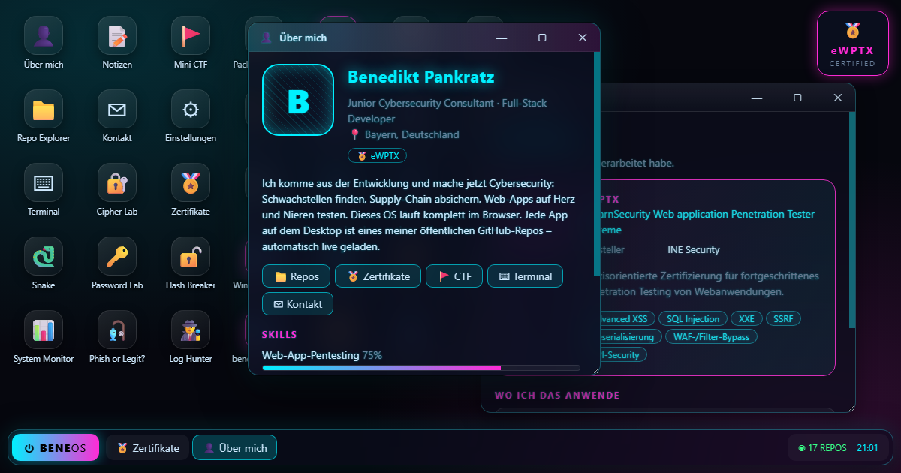

# BeneOS

> A cyber-themed operating system that runs entirely in your browser – the portfolio of **Benedikt Pankratz**, Junior Cybersecurity Consultant (eWPTX).

**Live:** https://beneos.netlify.app

## Features

- **Every public GitHub repo is an app** – loaded live from the GitHub API, with an offline snapshot as fallback. Security repos are highlighted.
- **Security Lab** with small, hands-on tools and games:
  Cipher Lab (encode/decode/hash), Password Lab (entropy & crack-time estimate), Hash Breaker (wordlist, mutation and brute-force attacks), Log Hunter (find the attacker in SSH logs), Packet Defender (arcade firewall), Phish or Legit? (quiz).
- **Mini CTF** with 8 flags hidden across the OS (login screen, terminal, file system, DevTools console …).
- **Terminal** with commands like `nmap` (simulated), `ls`, `cat`, `repos`, `theme`.
- **File explorer**, **achievements**, window manager, start menu, taskbar, boot and login screen.
- **Retro-style sounds**, fully synthesized with the Web Audio API (no audio files).
- Modern glass UI, no framework, no build step, no tracking, no cookies.

## Customize

- `os.js` → `PROFILE` block at the top: name, bio, skills, certificates (date / credential ID / verify link), live projects, links.
- `lab.js`, `lab2.js` → Security Lab apps, achievements and file explorer.
- `sounds.js` → sound effects.

Run locally: open `index.html`, or `npx serve .`

## Deploy (Netlify)

`netlify.toml` configures everything: publish directory, security headers (CSP, HSTS, X-Frame-Options, …) and a build step
(`scripts/update-repos.mjs`) that refreshes the offline repo snapshot on every deploy.

## Security notes

- Strict Content-Security-Policy; the only external connection is `api.github.com`.
- All GitHub data is escaped before rendering; README text is inserted as plain text.
- Everything in the Security Lab runs locally in the browser. Nothing is sent anywhere, and the `nmap` command is a simulation.

## License

[MIT](LICENSE) © Benedikt Pankratz
